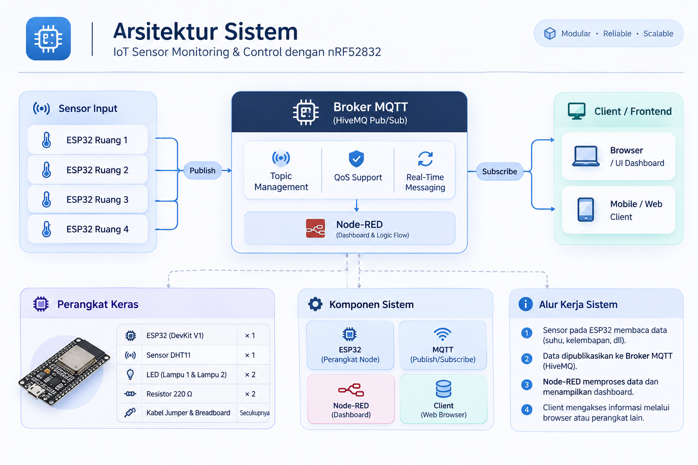
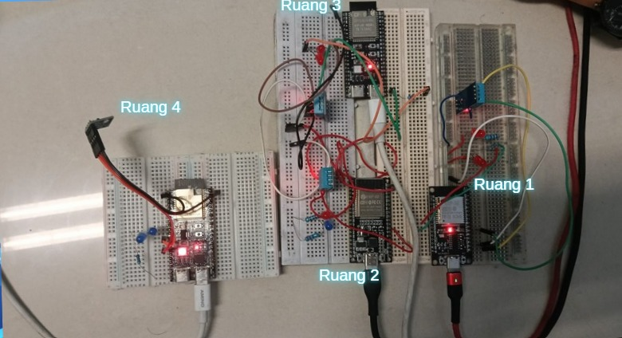
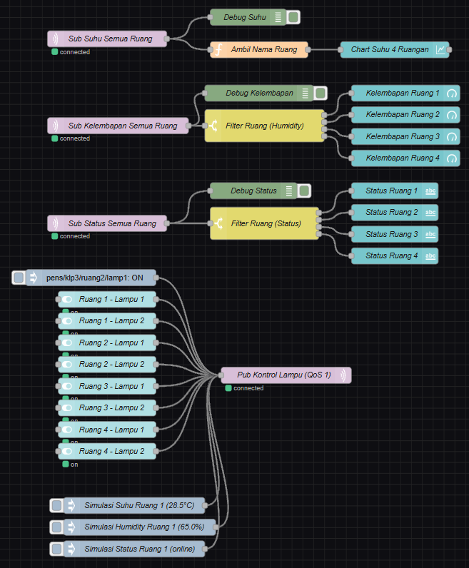
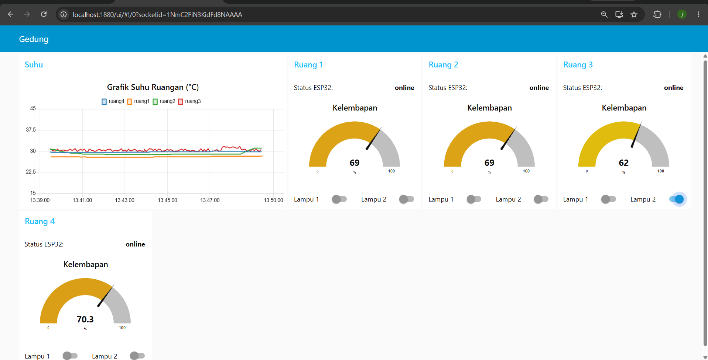

# Kel3-TugasNodeRED-ESP32

Sistem pemantauan suhu & kelembapan serta pengendalian lampu untuk **4 ruangan**
(`ruang1`–`ruang4`) berbasis **ESP32** dan **Node-RED** melalui protokol **MQTT**.
Setiap ruangan memiliki satu ESP32 dengan sensor **DHT11** dan **2 lampu LED**.
Data suhu/kelembapan dikirim ke broker publik **HiveMQ**
(`broker.mqttdashboard.com:1883`), lalu ditampilkan di dashboard Node-RED
(chart 4 ruangan, gauge kelembapan, status online/offline, dan 8 saklar lampu).

> Semua topic memakai prefix kelompok `pens/klp3/...` agar tidak tercampur
> dengan kelompok lain di broker publik.

---

## 🎥 Video

| Video | Durasi | Link |
|---|---|---|
| Video presentasi | maks. 7 menit | [YouTube: Video Presentasi](https://youtu.be/euNMfejJ7-Y?feature=shared) |
| Video demo alat | maks. 5 menit | [YouTube: Video Demo Alat](https://youtu.be/euNMfejJ7-Y?feature=shared) |

---

## Supported By

> - Dosen Pengampu : Akhmad Hendriawan ST., MT. (NIP.197501272002121003)
> - Mata Kuliah : IoT dan Jaringan Sensor
> - Program Studi : Sarjana Terapan Teknik Elektronika
> - Politeknik Elektronika Negeri Surabaya

---

## Team Member

| No | NRP | Nama | Ruangan | Jobdesk | GitHub |
|---|---|---|---|---|---|
| 1 | 2124600061 | Agmila Salsabila | `ruang1` | README & dokumentasi | [@agmilaoca-pixel](https://github.com/agmilaoca-pixel) |
| 2 | 2124600073 | Muhammad Ziat Thoriq | `ruang2` | Program ESP32 | [@Zthorrr](https://github.com/Zthorrr) |
| 3 | 2124600076 | Joshua Gamylael | `ruang3` | Flow & dashboard Node-RED | [@JosGmyl](https://github.com/JosGmyl) |
| 4 | 2124600077 | Fadiaz Arta Maulana | `ruang4` | Hardware & pengujian | [@fadiazarts](https://github.com/fadiazarts) |

> Setiap anggota memegang satu ruangan. Jobdesk boleh disesuaikan.

---

## Daftar Isi

- [Deskripsi Project](#kel3-tugasnodered-esp32)
- [Video](#-video)
- [Team Member](#team-member)
- [Arsitektur Sistem](#arsitektur-sistem)
- [Perangkat Keras](#perangkat-keras)
- [Rancangan Topic MQTT](#rancangan-topic-mqtt)
- [Cara Menjalankan](#cara-menjalankan)
- [Screenshot Flow & Dashboard](#screenshot-flow--dashboard)
- [Hasil Pengujian](#hasil-pengujian-t1t12)
- [Ruangan yang Disimulasikan](#ruangan-yang-disimulasikan)
- [Kendala dan Solusi](#kendala-dan-solusi)
- [Pembagian Tugas](#pembagian-tugas)

---

## Arsitektur Sistem

- **ESP32** membaca DHT11 tiap 5 detik → publish `temperature` & `humidity`,
  mendengarkan `lamp1`/`lamp2`, dan mengumumkan status `online`/`offline` (LWT).
- **Broker** meneruskan pesan antar client (QoS 0 untuk sensor, QoS 1 untuk lampu).
- **Node-RED** berlangganan dengan wildcard dan menampilkan dashboard di `/ui`,
  serta mengirim perintah lampu ke `.../ruangN/lamp1` dan `.../ruangN/lamp2`.

---

## Perangkat Keras

### Komponen per ruangan

| Komponen | Jumlah |
|---|---|
| ESP32 (DevKit V1) | 1 |
| Sensor DHT11 | 1 |
| LED (lampu 1 & lampu 2) | 2 |
| Resistor 220 Ω | 2 |
| Kabel jumper & breadboard | secukupnya |

### Tabel pin (saran)

| Komponen | Pin ESP32 | Catatan |
|---|---|---|
| DHT11 – VCC | 3.3V | |
| DHT11 – GND | GND | |
| DHT11 – DATA | GPIO16 | Robo ESP32 Cytron: port Grove 1 |
| LED lampu 1 + resistor 220 Ω | GPIO25 | Anoda ke pin, katoda ke GND lewat resistor |
| LED lampu 2 + resistor 220 Ω | GPIO26 | Sama seperti lampu 1 |

> Pin lain diperbolehkan selama dicatat di laporan.

### Foto rangkaian

---

## Rancangan Topic MQTT

Prefix wajib: `pens/klp3/<nama_ruang>/<fungsi>`.

| Topic | Arah | Payload | QoS | Retain |
|---|---|---|---|---|
| `pens/klp3/ruangN/temperature` | ESP32 → Node-RED | °C, 1 desimal, mis. `28.5` | 0 | tidak |
| `pens/klp3/ruangN/humidity` | ESP32 → Node-RED | %, 1 desimal, mis. `65.0` | 0 | tidak |
| `pens/klp3/ruangN/lamp1` | Node-RED → ESP32 | `1` = nyala, `0` = mati | 1 | tidak |
| `pens/klp3/ruangN/lamp2` | Node-RED → ESP32 | `1` = nyala, `0` = mati | 1 | tidak |
| `pens/klp3/ruangN/status` | ESP32 / LWT | `online` / `offline` | 0 | ya |

**Wildcard yang dipakai di node `mqtt in` Node-RED:**

| Tujuan | Topic subscribe |
|---|---|
| Suhu semua ruangan | `pens/klp3/+/temperature` |
| Kelembapan semua ruangan | `pens/klp3/+/humidity` |
| Status semua ruangan | `pens/klp3/+/status` |
| Semua topic kelompok (untuk cek) | `pens/klp3/#` |

**Broker:** `broker.mqttdashboard.com:1883` (HiveMQ publik).

---

## Cara Menjalankan

### 1. Library Arduino

Pasang lewat *Sketch → Include Library → Manage Libraries*:

- `EspMQTTClient` oleh Patrick Lapointe (Wi-Fi + MQTT + reconnect)
- `DHT sensor library` oleh Adafruit (+ `Adafruit Unified Sensor` bila diminta)

### 2. Upload ke ESP32

1. Buka `esp32/esp32_ruang/esp32_ruang.ino`.
2. Salin `secrets.example.h` menjadi `secrets.h`, isi `WIFI_SSID` & `WIFI_PASS`.
   (File `secrets.h` sudah di-`.gitignore` — jangan commit kredensial asli.)
3. Ganti **hanya** konstanta `ROOM` (`ruang1` … `ruang4`) sesuai board.
4. Pilih board & port, lalu **Upload**. Buka Serial Monitor (115200) —
   akan muncul `MQTT Connection established.` bila berhasil.

### 3. Import flow ke Node-RED

1. Pasang paket palette: *Menu → Manage palette → Install* → `node-red-dashboard`.
2. *Menu → Import → Clipboard/File*, pilih `node-red/flows.json`, lalu **Deploy**.
3. Pastikan konfigurasi `mqtt-broker` menunjuk ke `broker.mqttdashboard.com:1883`
   (server & port harus sama persis dengan kode ESP32).

### 4. Buka dashboard

- Editor Node-RED : `http://localhost:1880`
- Dashboard        : `http://localhost:1880/ui`
- Dari HP (satu jaringan): `http://<IP_laptop>:1880/ui`

---

## Screenshot Flow & Dashboard

Flow Node-RED:

Dashboard `/ui`:

---

## Hasil Pengujian (T1–T12)

| No | Uji | Hasil | Keterangan |
|:---:|:---|:---:|:---|
| T1 | Koneksi | ✓ | Board ESP32 berhasil terhubung ke jaringan Wi-Fi lokal dan broker HiveMQ (`broker.mqttdashboard.com:1883`). Serial Monitor mencetak log `MQTT Connection established.` secara stabil tanpa *bootloop* atau *delay* penghambat. |
| T2 | Data 4 ruang | ✓ | Seluruh payload `temperature` dan `humidity` dari keempat ruangan berhasil terkirim secara berkala setiap ±5 detik. Pesan terbaca utuh pada tab Debug Node-RED melalui subscribe wildcard `pens/klp3/+/temperature` dan `pens/klp3/+/humidity`. |
| T3 | Chart suhu | ✓ | Elemen chart line pada UI dashboard (`/ui`) berhasil memplot 4 garis multi-series berwarna berbeda. Fungsi parser pada Node-RED membedakan garis secara presisi berdasarkan pembacaan `msg.topic` masing-masing ruangan. |
| T4 | Sensor berubah | ✓ | Respon sensor dinamis dan terisolasi. Pemberian rangsangan fisik (hembusan udara hangat) pada sensor DHT11 di ruang2 hanya menaikkan metrik suhu/kelembapan ruang2 secara *real-time*, sedangkan data sensor ruang lainnya tetap stabil. |
| T5 | Lampu tepat sasaran | ✓ | Saklar kendali beroperasi tepat sasaran (spesifik). Penekanan saklar Lampu 2 Ruang 3 pada dashboard via MQTT topic QoS 1 secara instan menyalakan aktuator LED fisik di pin GPIO ruangan tersebut tanpa memicu lampu ruangan lain. |
| T6 | Matikan lampu | ✓ | Pengiriman payload `"0"` dari dashboard berhasil mematikan LED terkait secara seketika, membuktikan kendali dua arah (bi-directional) berjalan sinkron tanpa kendala latensi. |
| T7 | Payload salah | ✓ | Mekanisme validasi payload berjalan baik. Pengujian manual via terminal dengan payload non-standar (misalnya string `"ON"`, angka `2`, atau teks acak) diabaikan oleh ESP32; status pin lampu tidak terganggu dan sistem tetap beroperasi normal. |
| T8 | Status online | ✓ | Indikator status seluruh ruangan pada Node-RED Dashboard menampilkan teks `online` sesaat setelah koneksi MQTT terjalin via mekanisme publikasi *retained message*. |
| T9 | LWT (cabut daya) | ✓ | Fitur *Last Will and Testament* (LWT) berjalan sesuai standar MQTT. Pemutusan catu daya ESP32 ruang4 memicu broker mengirimkan payload LWT `offline` secara otomatis dalam rentang 15–20 detik (1,5× keep-alive). |
| T10 | Retained message | ✓ | Node-RED yang di-deploy ulang (*Full Deploy*) maupun di-refresh dapat langsung memuat status koneksi terakhir (`online`/`offline`) dari broker seketika tanpa harus menunggu board ESP32 mem-publish ulang. |
| T11 | Reconnect | ✓ | Fitur auto-reconnect dari pustaka `EspMQTTClient` teruji tangguh. Ketika koneksi access point/hotspot sempat diputus selama 10 detik lalu diaktifkan kembali, ESP32 otomatis pulih dan melanjutkan streaming telemetri secara mandiri. |
| T12 | Akses dari HP | ✓ | Web UI dashboard dapat diakses responsif melalui browser smartphone dalam satu subnet LAN (`http://<IP_laptop>:1880/ui`). Pengontrolan 8 saklar sakelar lampu serta visualisasi grafik berjalan lancar tanpa kendala rendering. |

> Seluruh pengujian T1–T12 **berhasil (✓)** pada saat demo.

---

## Ruangan yang Disimulasikan

_(isi bila ESP32 kurang dari 4 — sebutkan ruangan mana yang disimulasikan dan
bagaimana caranya. Minimal 2 ruangan harus ESP32 sungguhan.)_

---

## Kendala dan Solusi

| Kendala | Solusi |
|---|---|
| _(contoh)_ Bacaan DHT11 selalu `nan` | Perbesar interval baca (DHT11 maks. 1×/detik) & pastikan VCC tersambung |
| _(contoh)_ Dua ESP32 saling putus-sambung | Pastikan `ROOM` berbeda sehingga Client ID unik |

---

## Pembagian Tugas

Setiap anggota minimal memiliki **2 commit** pada repositori ini. Tabel di bawah merangkum **2 commit paling vital** dari masing-masing anggota berdasarkan riwayat riil git (`git log`):

| Anggota | Commit 1 (Vital) | Commit 2 (Vital) |
|---|---|---|
| **Agmila Salsabila** ([@agmilaoca-pixel](https://github.com/agmilaoca-pixel)) | `98c5338`: Tambah tautan video presentasi & video demo pada `README.md` dan `video/LINK.md` | `a169c2c`: Lengkapi username GitHub seluruh anggota kelompok pada tabel Team Member |
| **Muhammad Ziat Thoriq** ([@Zthorrr](https://github.com/Zthorrr)) | `878ae31`: Unggah laporan PDF, kode program ESP32, flow Node-RED, dan isi hasil uji T1–T12 | `4949011`: Perbarui deskripsi teknis dan elaborasi hasil pengujian T1–T12 pada README |
| **Joshua Gamylael** ([@JosGmyl](https://github.com/JosGmyl)) | `d59b7c3`: Inisialisasi awal repositori proyek (`Initial commit`) | `51b9de9`: Tambah gambar blok diagram arsitektur sistem dan rapikan tautan video |
| **Fadiaz Arta Maulana** ([@fadiazarts](https://github.com/fadiazarts)) | `bbd737c`: Buat kerangka lengkap `README.md` dan struktur pembagian anggota kelompok | `322a913`: Sesuaikan struktur direktori repo dengan aturan tugas (docs, images, laporan) |

---

## Referensi

- Slide *Node-RED dan ESP32* (hal. 19–27)
- [Cytron: Getting Started with ESP32 & Node-RED](https://cytron.io/tutorial/getting-started-esp32-and-nodered)
- [EspMQTTClient](https://github.com/plapointe6/EspMQTTClient)
- [Node-RED docs](https://nodered.org/docs/getting-started)
- [Node-RED Dashboard](https://flows.nodered.org/node/node-red-dashboard)
